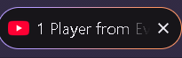
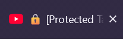

# 🔒 Firefox Tab Censor Extension

> Ekstensi Firefox ringan yang dirancang untuk menjaga privasi layar (*screen privacy*) dengan menyensor atau mengubah judul tab browser secara instan. Sangat cocok untuk *content creator*, pekerja *remote*, atau saat melakukan presentasi/live streaming agar tidak tidak sengaja membocorkan informasi sensitif.

---

## ✨ Fitur Utama

- **Tab Title Masking:** Mengubah judul halaman web secara otomatis menjadi teks kustom atau generik yang aman.
- **Dynamic Protection:** Tetap mengamankan judul tab meskipun halaman web memuat ulang (*reload*) atau mengubah judulnya secara dinamis.
- **Lightweight & Fast:** Dibangun menggunakan *WebExtensions API* murni tanpa dependensi berat yang memperlambat browser.
- **Privacy First:** Berjalan sepenuhnya di perangkat lokal (*client-side*) tanpa mengirimkan data penjelajahan ke server luar.

---

## 🛠️ Teknologi yang Digunakan

- **JavaScript (ES6+)** - Logika utama ekstensi dan manipulasi DOM.
- **HTML5 & CSS3** - Antarmuka menu *popup*.
- **Firefox WebExtensions API** (`tabs`, `storage`, `content_scripts`).

---

## 📂 Struktur Proyek

```text\
firefox-tab-censor/\
│\
├── manifest.json       # Konfigurasi utama ekstensi (Manifest V2)\
├── background.js       # Skrip latar belakang untuk menangani event\
├── content.js          # Skrip injeksi untuk memanipulasi judul halaman web\
├── popup.html          # Tampilan antarmuka saat ikon ekstensi diklik\
├── popup.js            # Logika interaksi pada menu popup\
└── icon.png            # Ikon ekstensi
```

---

# 🚀 Cara Instalasi & Pengujian (Development Mode)
Karena ekstensi ini dikembangkan secara mandiri (*local development*), kamu bisa memasangnya langsung ke Firefox secara manual:
1. Unduh atau clone repo ini
```bash
git clone https://github.com/username/firefox-tab-censor.git
```
2. Buka browser Firefox, lalu ketik tautan berikut di bilah alamat:
```bash
about:debugging
```
3. Klik menu "This Firefox" pada panel sebelah kiri.
4. Klik tombol Load Temporary Add-on...
5. Pilih file manifest.json yang ada di dalam folder proyek ekstensi ini.


---

## 📸 Hasil
<table>
  <tr>
    <td align="center">
      <b>Sebelum (Before)</b><br>
      
    </td>
    <td align="center">
      <b>Sesudah (After)</b><br>
      
    </td>
  </tr>
</table>
